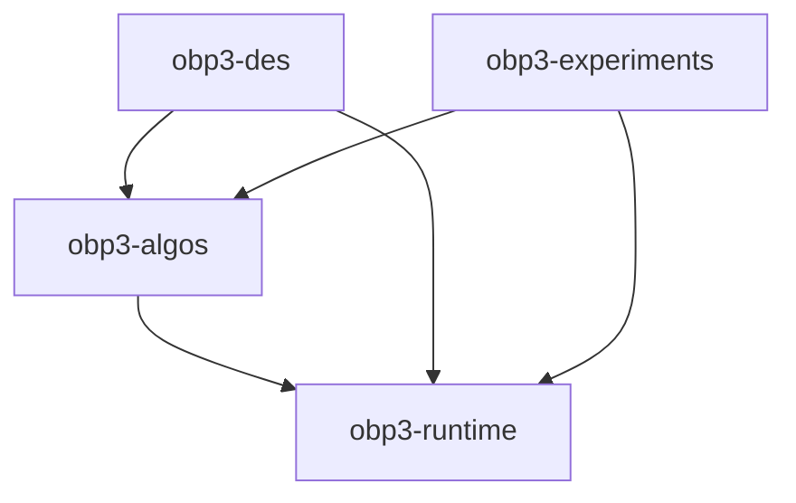

# OBP3 Core Project Map

Reviewed on 2026-09-24. This is a navigation aid for the `obp3-core` Gradle build, not a substitute for the source or an actively maintained issue tracker. Verify details against the current branch before making changes.

## Project Shape

The root project includes four modules, targets Java 23, and configures publication and versioning centrally. Start with [`settings.gradle`](../settings.gradle), the [root build](../build.gradle), and the module-specific build files.

| Module | Role | Guide |
| --- | --- | --- |
| `obp3-runtime` | Execution and semantic-relation contracts shared across the project | [Runtime](obp3-runtime.md) |
| `obp3-algos` | Graph traversal, model checking, SCC, fixed points, unification, and data structures | [Algorithms](obp3-algos.md) |
| `obp3-des` | Discrete-event simulation implemented as semantic-relation transitions | [DES](obp3-des.md) |
| `obp3-experiments` | JavaFX tools, trace monitoring experiments, demos, JMH, and native-image configuration | [Experiments](obp3-experiments.md) |



Arrows indicate a Gradle project dependency. The root build aggregates the modules; it is not a runtime library module.

## Request Routing

| Work area | Start here |
| --- | --- |
| Add/change an execution or semantic contract | [`obp3-runtime`](obp3-runtime.md), then inspect its callers |
| DFS/BFS behavior, callbacks, depth bounds | [`DepthFirstTraversal.java`](../obp3-algos/src/main/java/obp3/traversal/dfs/DepthFirstTraversal.java), `obp3-algos/src/main/java/obp3/traversal/`, and `obp3-algos/src/test/java/z2mc/traversal/` |
| SCC or Büchi/safety checking | `obp3-algos/src/main/java/obp3/scc/` or `obp3-algos/src/main/java/obp3/modelchecking/`; tests are under `obp3-algos/src/test/java/z2mc/` |
| Semantic products or graph adapters | `obp3-algos/src/main/java/obp3/sli/core/operators/` |
| Fixpoint engine or logic/unification | `obp3-algos/src/main/java/obp3/fixer/`, `unification/`, or `uslg/syntax/` |
| Custom hashing/collections/hash-consing | `obp3-algos/src/main/java/obp3/utils/`, `datastructures/collections/linearscan/`, or `hashcons/` |
| Event scheduling/simulation | [`DES guide`](obp3-des.md) |
| GUI, trace monitoring, or performance experiments | [`Experiments guide`](obp3-experiments.md) |

## Build And Tests

Run from this directory (the `obp3-core` root):

```sh
./gradlew build
./gradlew test
./gradlew :obp3-algos:test
```

At review time, Java tests were present only in `obp3-algos`; runtime, DES, and experiments had no `src/test` files. `build` already includes the test task. CI currently invokes both `build` and a separate `test` step.

JPMS module names differ from Gradle project names: `obp.sli.runtime`, `obp.algos`, `obp.des`, and `obp.experiments`. Check each module's `src/main/java/module-info.java` before exposing a package or using it from another named module.

## Static Review Hotspots

These are observations from source inspection, not test-verified issue reports; re-check before acting:

- DES action enumeration drains all events at the next timestamp before returning one action per event. Executing one branch can therefore lose its same-time alternatives, and querying actions mutates the configuration. See [`DESSemantics`](../obp3-des/src/main/java/obp3/des/DESSemantics.java) and [`DESConfiguration`](../obp3-des/src/main/java/obp3/des/DESConfiguration.java).
- `Hashable.fromComparator` can define equality inconsistent with its object-based hash; `withPositiveHash` does not make `Integer.MIN_VALUE` nonnegative. See [`Hashable`](../obp3-algos/src/main/java/obp3/utils/Hashable.java).
- `LinearScanHashMap` returns detached `keySet`, `values`, and `entrySet` snapshots rather than backed `Map` views. Its custom map/set also need review for standard `equals`/`hashCode` contracts. See [`LinearScanHashMap`](../obp3-algos/src/main/java/obp3/datastructures/collections/linearscan/LinearScanHashMap.java).
- The GS09 Büchi implementation accepts a reducer but its color/known map is keyed by original vertices. See [`EmptinessCheckerBuchiGS09`](../obp3-algos/src/main/java/obp3/modelchecking/buchi/ndfs/gs09/EmptinessCheckerBuchiGS09.java) and [`BuchiGS09BlueConfiguration`](../obp3-algos/src/main/java/obp3/modelchecking/buchi/ndfs/gs09/BuchiGS09BlueConfiguration.java).
- [`PeekableIterator`](../obp3-algos/src/main/java/obp3/utils/PeekableIterator.java) uses `null` as its empty-cache marker, so peeking an actual null element is ambiguous. `Unificator` should also be checked for the identity equation `X = X`.
- `obp3-experiments` has no tests; the trace-inclusion operator currently has no in-repository construction/wiring path. JMH is configured to include only `FibonacciBench`, and `BFSBench` contains two identically implemented traversal methods under different names.

## Keeping This Map Useful

Treat code and tests as authoritative. Update this folder when modules, package ownership, public entry points, or test locations change. Prefer adding exact class/test links here over duplicating implementation details.